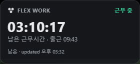
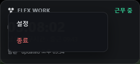
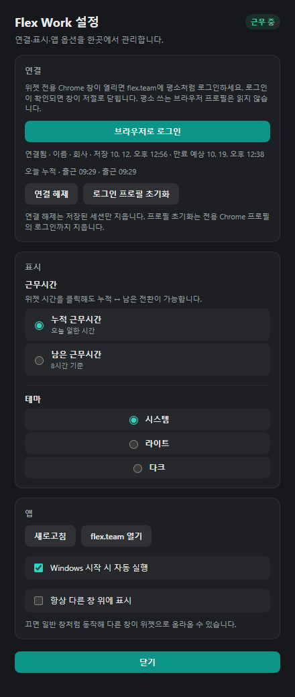

# Flex Work Widget

Windows 바탕화면에 띄워 두는 Flex 오늘 누적 근무시간 위젯입니다.  
`cursor-usage-widget`와 같은 Tauri 2 데스크톱 위젯 형태입니다.



테두리 없는 280×128 창이 바탕화면 위에 떠 있습니다. 작업 표시줄에는 잡히지 않습니다.

| 위치 | 내용 |
|---|---|
| 우측 상단 배지 | `출근 전` / `근무 중` / `휴게 중` / `퇴근` |
| 큰 숫자 | 현재 표시 모드의 시간 (`HH:MM:SS`) — 근무 중이면 1초마다 올라갑니다 |
| 그 아래 줄 | 표시 모드 이름 · 오늘 출근 시각 |
| 맨 아래 줄 | 표시 모드 약어 · 마지막 갱신 시각 (연결 전이면 `우클릭 → 설정 → 브라우저로 로그인`) |

## 사용법

1. `시작.bat` 으로 실행하면 위젯이 마지막 위치에 뜹니다
2. 처음 한 번은 [첫 연결](#첫-연결)로 전용 Chrome 창에서 flex에 로그인합니다
3. **큰 숫자를 클릭**하면 누적 ↔ 남은 근무시간이 바뀝니다 ([표시 모드](#표시-모드))
4. 창을 **드래그**하면 옮겨집니다 — 위치는 다음 실행에 복원됩니다
5. 그 밖의 모든 조작은 **우클릭 메뉴**에서 합니다 ([우클릭 메뉴](#우클릭-메뉴), [설정](#설정))

## 범위 (MVP)

- 오늘 **누적 근무시간** 표시 (`HH:MM:SS`)
- **출근 전**이면 그 상태 표시
- 근무 중 / 휴게 중 / 퇴근 상태 구분
- flex 웹 로그인 세션 사용 (Open API 토큰 불필요)

## 데이터 경로

비공식 웹 세션 방식입니다.

1. 설정의 **브라우저로 로그인**이 위젯 전용 프로필(`%LOCALAPPDATA%\FlexWorkWidget\login-profile\`)로
   진짜 Chrome 창을 띄웁니다. 사용자가 그 창에서 평소처럼(Google 등) 로그인합니다
2. 위젯은 그 창의 디버깅 포트(CDP)로 `flex.team` 쿠키만 읽어, 아래 API가 200을 돌려주면
   DPAPI로 봉인해 저장하고 창을 닫습니다
3. 저장한 쿠키로 다음 API를 평문 HTTP로 호출합니다  
   - `GET /api/v2/workspace/users/me/workspace-users`  
   - `GET /api/v2/time-tracking/work-clock/users/{userIdHash}/current-status`
4. 응답의 근무/휴게 블럭으로 오늘 누적 시간을 계산합니다

flex 웹 구조가 바뀌면 깨질 수 있습니다. 설계·실측 근거는 rag
`docs/assets/2026-10-12-widget-dedicated-profile-login-plan.md`에 있습니다.

### 세션 수명과 무인 갱신

실측(2026-10-12, Chrome 154): 인증에 쓰이는 쿠키는 `AID`(만료 7일)입니다. `V2_WS_AID`(12시간)만으로는 401이고,
`V2_WS_RID`는 새 로그인에서 생기지 않습니다.

- API가 401/403이면 같은 전용 프로필을 **화면 없이(headless)** 띄워 쿠키를 다시 읽고, 통하면 저장합니다
- `AID` 만료가 24시간 안으로 들어오면 같은 갱신을 미리 한 번 시도합니다
- 갱신은 30분에 한 번 이하이며, 로그인 창이 떠 있는 동안에는 하지 않습니다
- 실패하면 `로그인 필요`가 되고, 설정의 **브라우저로 로그인**을 누르면 됩니다. 전용 프로필에 로그인이
  남아 있으면 창이 떴다가 바로 닫힙니다

### 제약

- Chrome 또는 Edge가 설치돼 있어야 합니다(App Paths 레지스트리 → 설치 폴더 순으로 찾고, 시험용으로
  `FLEX_BROWSER_PATH` 환경변수로 덮어쓸 수 있습니다)
- 세션 파일은 DPAPI로 Windows 계정에 묶여 있어 다른 PC·계정으로 복사하면 풀리지 않습니다. 기기마다 한 번 로그인합니다
- 평소 쓰는 Chrome/Edge 프로필은 읽지도 건드리지도 않습니다. 관리자 권한(UAC)·Python이 필요 없습니다

## 실행

일상 사용: `시작.bat`  
→ 릴리즈 exe를 `%LOCALAPPDATA%\FlexWorkWidget\`에 두고 실행합니다. 커맨드창은 남지 않습니다.  
→ 처음 한 번은 빌드가 필요할 수 있습니다 (`npm run build:app`).  
→ 위젯에서 **우클릭 → 시작프로그램** 으로 부팅 시 자동 실행을 켭니다.  
  (항상 위 설치 경로만 등록하므로, `target\debug` exe를 직접 켜도 시작프로그램이 깨지지 않습니다.)

개발(핫 리로드): `시작-개발.bat` 또는

```powershell
cd C:\Users\cykim\repo\flex-work-widget
npm install
npm run tauri dev
```

### 첫 연결

앱 내 WebView 로그인 창은 flex(특히 Google 로그인)에서 **하얀 화면**이 나므로 쓰지 않습니다.

위젯 **우클릭 → 설정 → 브라우저로 로그인**:

1. 확장·북마크 없는 Chrome 창이 `flex.team`으로 열립니다(위젯 전용 프로필)
2. 그 창에서 평소처럼 로그인합니다(Google 로그인 포함)
3. 로그인이 확인되면 창이 저절로 닫히고 위젯에 근무시간이 표시됩니다. 제한 시간은 5분이고,
   창을 직접 닫으면 바로 취소됩니다

예전 방식(평소 Chrome/Edge 쿠키 DB를 rookiepy로 복호화, UAC 필요)은 없앴습니다. 새로 로그인해 처음 저장할 때
옛 평문 `session.json`·`candidates.json`·`harvest-pref.json`은 지워집니다.

## 우클릭 메뉴

위젯 아무 곳이나 **우클릭**하면 클릭한 자리에 메뉴가 열립니다. 바깥을 클릭하거나 `Esc`,
또는 다른 창으로 포커스가 넘어가면 닫힙니다.



- **설정** — 연결·표시·앱 옵션 (시작프로그램, 항상 위에 표시 포함)
- **종료** — 앱을 완전히 끕니다 (바로 아래 있으니 잘못 누르지 않도록 주의)

## 표시 모드

시간 숫자 클릭 또는 **우클릭 → 설정**에서 전환합니다.

- **누적 근무시간**: 오늘 근무한 시간
- **남은 근무시간**: `8시간 − 누적` (0 미만이면 00:00:00)

## 설정

**우클릭 → 설정** 으로 별도 창을 엽니다. 변경 사항은 **즉시** 메인 위젯에 반영됩니다
(저장 버튼 없음). `Esc` 또는 **닫기**로 닫으면 창은 숨겨질 뿐 앱은 계속 돕니다.



> 스크린샷은 창 내용 전체를 한 번에 캡처한 모습입니다(제목 표시줄 제외, 계정 이름은 가림).
> 기본 크기는 440×620이라 실제로는 세로 스크롤이 생깁니다.

| 블록 | 하는 일 |
|---|---|
| **연결** | `브라우저로 로그인`(전용 Chrome 창). 상태 줄에 연결됨 · 계정(이름 · 회사) · 저장 시각 · 만료 예상이, 그 아래에 현재 근무 상태나 연결 안 된 이유가 나옵니다. `연결 해제`는 저장 세션만 지우고, `로그인 프로필 초기화`(두 번 눌러 실행)는 전용 프로필의 로그인까지 지웁니다 |
| **표시** | **근무시간**은 누적 ↔ 남은 전환, **테마**는 시스템/라이트/다크 |
| **앱** | `새로고침`(즉시 재조회), `flex.team 열기`(기본 브라우저), `Windows 시작 시 자동 실행`, `항상 다른 창 위에 표시` |

창 우측 상단 배지는 위젯과 같은 현재 근무 상태입니다.

**항상 다른 창 위에 표시**를 끄면 일반 창처럼 동작해서 다른 창이 위젯을 덮을 수 있습니다.
이 선택은 백엔드가 들고 있어 재시작 후에도 유지됩니다.

## 테마

설정 창 **표시 → 테마**에서 선택합니다. 기본값은 **시스템**입니다.

## 개발·배포

- 에이전트/개발자 작업 완료 후 강제 재빌드·재시작: `npm run rebuild:restart`
- 일반 사용자: `시작.bat` (소스가 exe보다 최신일 때만 빌드, 설치본 해시 불일치 시 재복사)
- 재시작 스크립트는 **빌드 전에** 기존 위젯을 모두 종료한다 (구 UI가 남지 않음)

우클릭 → **종료**로 앱을 닫습니다.

## 개발 메모

- 세션 파일: `%LOCALAPPDATA%\FlexWorkWidget\session.dat` (DPAPI 봉인 JSON, 커밋 금지)
- 로그인 프로필: `%LOCALAPPDATA%\FlexWorkWidget\login-profile\` (위젯 전용 Chrome user-data-dir)
- 로그인 모듈: `src-tauri/src/browser_login.rs`(브라우저 찾기·실행·CDP·로그인 대기·무인 갱신),
  `src-tauri/src/secure_store.rs`(DPAPI 봉인·원자 쓰기). 서비스별 값은 `work.rs`의 `FLEX_LOGIN`(`LoginSpec`) 하나뿐이라
  다른 위젯이 두 파일을 그대로 복사해 쓸 수 있습니다
- 로그인 흐름 스파이크: `node scripts/spike_browser_login.mjs` (쿠키 메타데이터만 출력, 값은 출력하지 않음)
- 폴링 기본 간격: 60초 (근무 중에는 UI에서 1초 단위로 로컬 틱)
- 쿠키 값·계정 정보는 로그·오류 문구에 남기지 않고, flex API는 리디렉션을 따르지 않습니다
